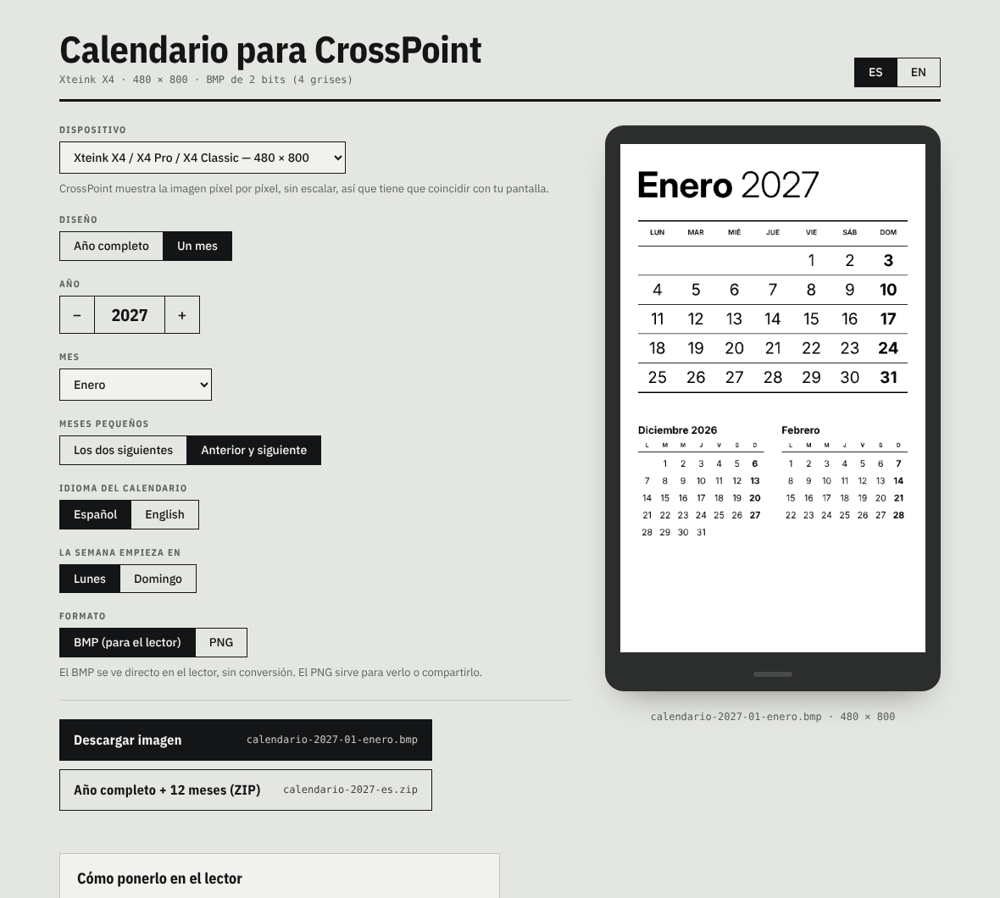
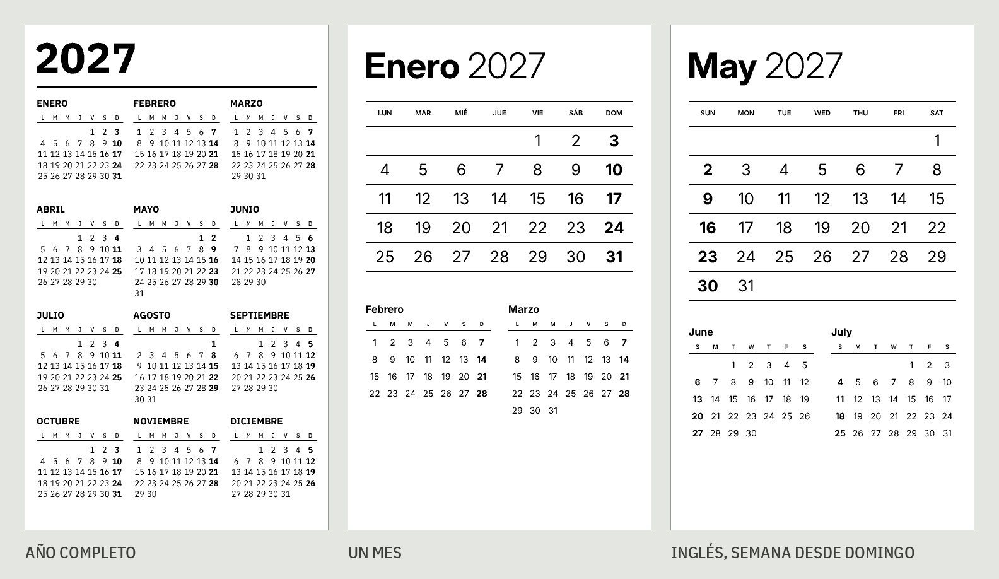
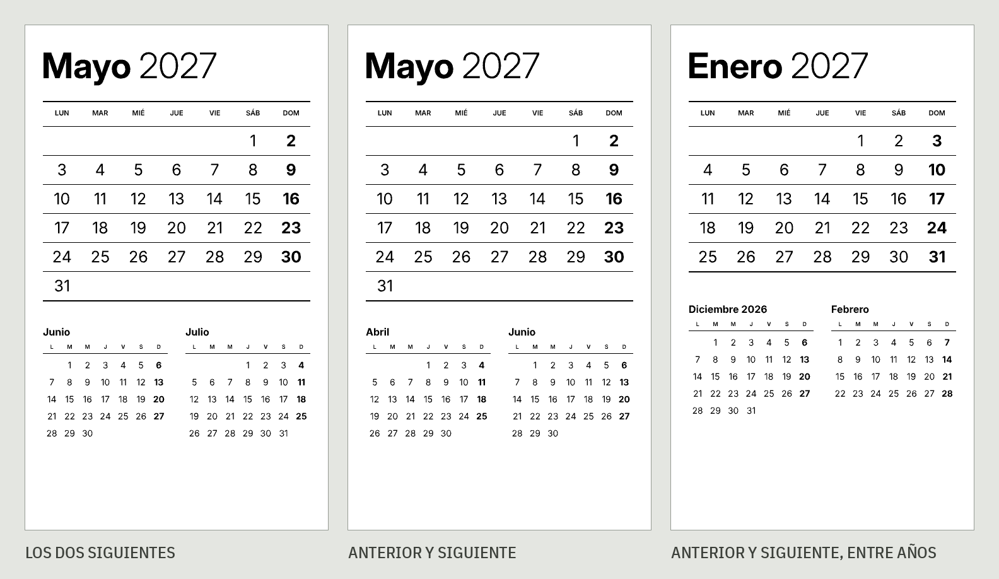

# CrossPoint Calendar

Un generador web de calendarios para la pantalla de reposo de [CrossPoint Reader](https://crosspointreader.com/), hecho para el Xteink X4 Pro y compatible con todas las pantallas que soporta CrossPoint.

**Úsalo aquí: [aendom.github.io/crosspoint-calendar](https://aendom.github.io/crosspoint-calendar/)**

*[Read in English](README.md)*

Elige tu dispositivo, un diseño, un año y, si quieres, un mes. Descarga la imagen y cópiala a tu lector. Todo funciona en tu navegador: no hay servidor, no necesitas cuenta y no hay nada que instalar.

## Qué puedes generar

- **Año completo**: los 12 meses en una sola pantalla.
- **Un mes**: el mes en grande, con dos meses pequeños abajo: los dos siguientes, o el anterior y el siguiente.
- **Año completo + 12 meses (ZIP)**: la imagen del año y las 12 de los meses en una sola descarga.

Los calendarios vienen en **español o inglés**, y la semana puede empezar en **lunes o domingo**. Los domingos van en negritas.

Estas son las imágenes reales que descarga el generador, al tamaño del Xteink X4: 480 × 800.

### Meses pequeños

En el diseño mensual eliges qué dos meses van debajo del mes principal: los **dos siguientes**, o el **anterior y el siguiente**. Cuando un mes pequeño es de otro año, aparece con el año.

## Dispositivos

CrossPoint muestra la imagen de reposo píxel por píxel, sin escalar, así que tiene que coincidir con la pantalla. Elige tu dispositivo y los dos diseños se ajustan a su tamaño. Los tamaños vienen del firmware de CrossPoint y de su SDK de pantallas:

| Dispositivo | Tamaño (vertical) |
|---|---|
| Xteink X4 / X4 Pro / X4 Classic | 480 × 800 |
| Xteink X3 | 528 × 792 |
| M5 PaperMono / PaperMono Lite | 480 × 800 |
| Seeed reTerminal Sticky | 480 × 800 |
| Boox Picco | 480 × 800 |
| Metalio E-Ink 4 | 480 × 800 |
| EEGOREAD A4 | 552 × 768 |
| Personalizado | cualquier tamaño de 240 a 2048 px |

Los archivos del tamaño X4 conservan su nombre simple (`calendario-2027.bmp`). Los demás tamaños agregan el dispositivo, por ejemplo `calendario-2027-x3.bmp`.

## Cómo ponerlo en el lector

1. Descarga el **BMP**.
2. Cópialo a la raíz de la tarjeta SD con el nombre **`sleep.bmp`**.
3. En el lector, ve a **Settings → Display → Sleep Screen** y elige **Custom**.

Listo. Aparece cada vez que el lector se duerme.

### Cambiar el mes desde el lector

Descarga el ZIP y copia las 12 imágenes de los meses a una carpeta de la SD, por ejemplo `/calendario`. Al empezar cada mes, abre la imagen que toca en **Browse Files** y ponla como pantalla de reposo desde el mismo lector. No necesitas computadora ni Wi-Fi.

No pongas las imágenes de los meses en la carpeta `/.sleep`. CrossPoint elige una imagen al azar de esa carpeta y te saldría un mes equivocado.

## Por qué BMP

Las pantallas de CrossPoint muestran 4 niveles de gris, y CrossPoint dibuja los BMP de 2 bits directamente, sin convertirlos. El generador crea justo ese formato (unos 94 KB por imagen del X4), así que la vista previa de la página es igual a lo que se ve en el lector. El PNG es para ver o compartir el calendario.

## Notas de diseño

- **Fuentes:** [IBM Plex Sans](https://fonts.google.com/specimen/IBM+Plex+Sans) y Plex Sans Condensed en el diseño anual, donde los números condensados dan aire a las columnas angostas. [Inter](https://fonts.google.com/specimen/Inter) en el diseño mensual.
- **Sin texto gris.** Los días de la semana van en negro sólido, porque el gris claro se pierde en el papel electrónico.
- **Todos los meses ocupan seis renglones**, así el ritmo de la cuadrícula del año es igual mes con mes.

## Úsalo por tu cuenta

Todo el generador es `index.html` y la carpeta `fonts/`. Ábrelo en cualquier navegador, o haz un fork de este repositorio y activa GitHub Pages (**Settings → Pages → Deploy from a branch → `main` / root**).

## Licencia

MIT. Las fuentes de `fonts/` (IBM Plex e Inter) usan la licencia SIL Open Font License.

Este proyecto no está afiliado a CrossPoint Reader.
