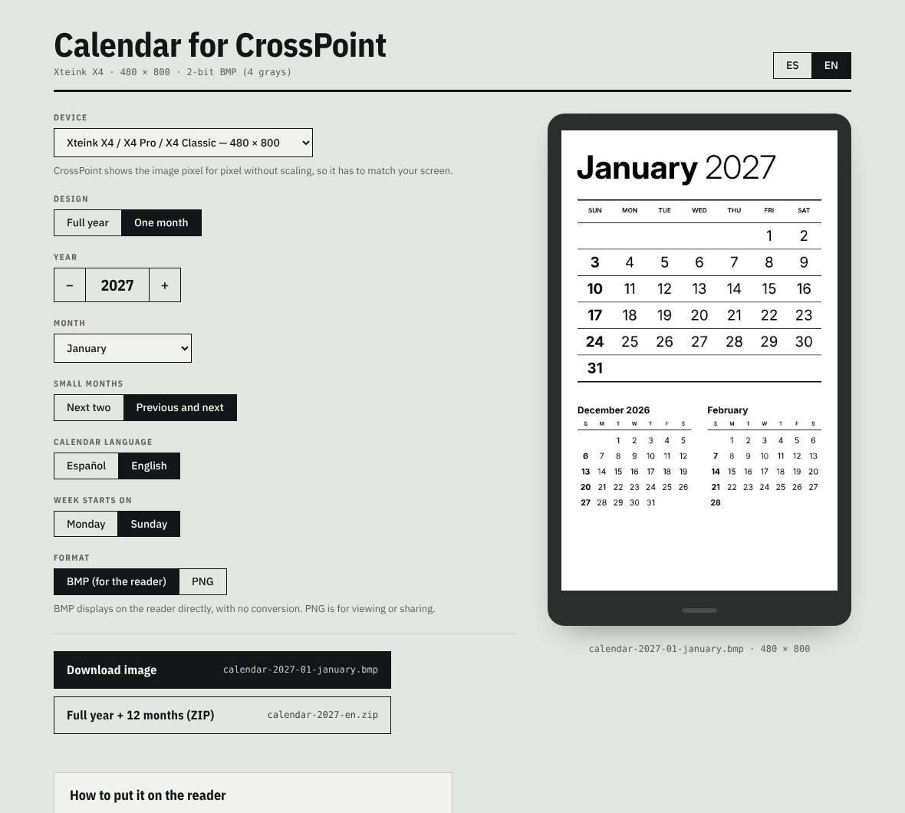
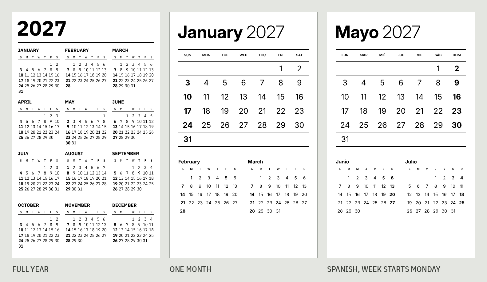
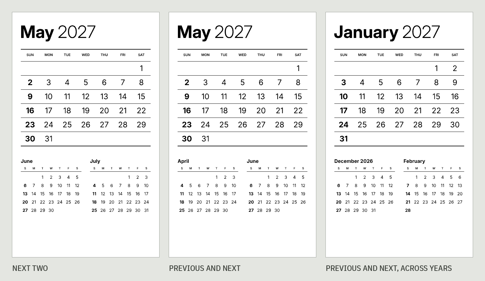

# CrossPoint Calendar

A web generator for e-ink calendar images for [CrossPoint Reader](https://crosspointreader.com/). Made for the Xteink X4 Pro, and it works with every screen CrossPoint supports.

**Use it here: [aendom.github.io/crosspoint-calendar](https://aendom.github.io/crosspoint-calendar/)**

*[Leer en español](README.es.md)*

Pick your device, a design, a year and, if you want, a month. Then download the image and copy it to your reader. Everything runs in your browser: there is no server, no account and nothing to install.

## What you can make

- **Full year**: all 12 months on one screen.
- **One month**: the month large, with two small months below: the next two, or the month before and the month after.
- **Full year + 12 months (ZIP)**: the year image and all 12 month images in one download.

Calendars come in **Spanish or English**, with the week starting on **Monday or Sunday**. Sundays are bold.

These are the actual images the generator downloads, at the Xteink X4's 480 × 800 size.

### Small months

In the month design, choose which two months go below the main grid: the **next two**, or the **month before and the month after**. When a small month falls in another year, it shows the year.

## Devices

CrossPoint shows the sleep image pixel for pixel without scaling, so the image has to match the screen. Pick your device and both designs adapt to its size. Sizes come from the CrossPoint firmware and its display SDK:

| Device | Size (portrait) |
|---|---|
| Xteink X4 / X4 Pro / X4 Classic | 480 × 800 |
| Xteink X3 | 528 × 792 |
| M5 PaperMono / PaperMono Lite | 480 × 800 |
| Seeed reTerminal Sticky | 480 × 800 |
| Boox Picco | 480 × 800 |
| Metalio E-Ink 4 | 480 × 800 |
| EEGOREAD A4 | 552 × 768 |
| Custom | any size from 240 to 2048 px |

Files for the X4 size keep plain names (`calendar-2027.bmp`). Other sizes add the device, for example `calendar-2027-x3.bmp`.

## Put it on your reader

1. Download the **BMP**.
2. Copy it to the root of the SD card and name it **`sleep.bmp`**.
3. On the reader, go to **Settings → Display → Sleep Screen** and choose **Custom**.

That's it. It shows every time the reader goes to sleep.

### Change the month from the reader

Download the ZIP and copy the 12 month images to a folder on the SD card, for example `/calendar`. At the start of each month, open the right image in **Browse Files** and set it as the sleep screen from the reader itself. You don't need a computer or Wi-Fi.

Don't put the month images in the `/.sleep` folder. CrossPoint picks a random image from that folder, so you'd get the wrong month.

## Why BMP

CrossPoint screens show 4 levels of gray, and CrossPoint draws 2-bit BMP files directly, with no conversion. The generator writes exactly that format (about 94 KB for an X4 image), so the preview on the page is exactly what the reader shows. PNG is there for viewing or sharing the calendar.

## Design notes

- **Fonts:** [IBM Plex Sans](https://fonts.google.com/specimen/IBM+Plex+Sans) and Plex Sans Condensed for the year design, where the condensed figures give the narrow date columns room. [Inter](https://fonts.google.com/specimen/Inter) for the month design.
- **No gray text.** Weekday labels are solid black because light gray washes out on e-paper.
- **Every month block has six rows**, so the rhythm of the year grid stays the same from month to month.

## Run it yourself

The whole generator is `index.html` plus the `fonts/` folder. Open it in any browser, or fork this repo and turn on GitHub Pages (**Settings → Pages → Deploy from a branch → `main` / root**).

## License

MIT. The fonts in `fonts/` (IBM Plex and Inter) are under the SIL Open Font License.

Not affiliated with the CrossPoint Reader project.
